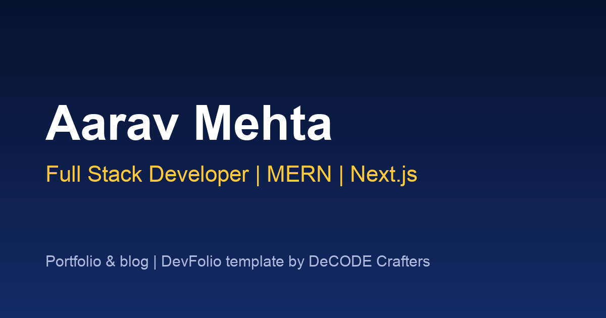

# DevFolio: Portfolio & Blog for Developers

**Live demo:** https://dcc-student-portfolio.vercel.app

A fast, SEO-ready portfolio and blog that every student can make their own in an afternoon:
projects with screenshots and tech tags, an About page, and a Markdown blog with code highlighting.
Built by [DeCODE Crafters](https://decodecrafters.in) for learners in our web development courses.



## Features

- **Home page** with your role, intro, skills and featured projects
- **Projects** page with cover images, descriptions and tech tags
- **Blog** in Markdown/MDX: code highlighting, tags, search (⌘K), RSS feed
- **About** page with your story, experience and links
- Dark and light themes, mobile-first layout, sitemap and social preview images

Tech: Next.js 15, React 19, Tailwind CSS 4, Contentlayer, MDX.

## Make it yours (15 minutes)

All your content lives in `data/`:

| File | What to change |
| --- | --- |
| `data/siteMetadata.js` | Your name, role, intro, skills, links, site URL |
| `data/authors/default.mdx` | Your About page: story, experience, what you're learning |
| `data/projectsData.ts` | Your projects (add 16:9 images to `public/static/images/projects/`) |
| `data/blog/*.mdx` | Your posts (delete the samples) |
| `public/static/images/` | `avatar.png`, `logo.png`, `twitter-card.png` (1200×630) |

The sample person, "Aarav Mehta", and the sample projects are placeholders. Replace them before you share your site.

## Run it locally

```bash
node .yarn/releases/yarn-3.6.1.cjs install
node .yarn/releases/yarn-3.6.1.cjs dev
```

Open http://localhost:3000.

## Deploy for free

1. Push your copy to a **public** GitHub repo.
2. On [vercel.com](https://vercel.com), choose **Add New → Project** and import the repo. Vercel detects Next.js automatically.
3. Every push to `main` redeploys the site.

## Optional extras

- **Comments:** fill the `NEXT_PUBLIC_GISCUS_*` variables (see [giscus.app](https://giscus.app)); the comments section appears on posts.
- **Newsletter:** set `newsletter.provider` in `data/siteMetadata.js` and that provider's environment variables.
- **Résumé button:** put a PDF in `public/static/` and set `resumeUrl`.

## Credits and licence

Based on [Tailwind Nextjs Starter Blog](https://github.com/timlrx/tailwind-nextjs-starter-blog) by Timothy Lin (MIT).
DevFolio changes © 2026 DeCODE Crafters, also MIT. See [LICENSE](LICENSE).
